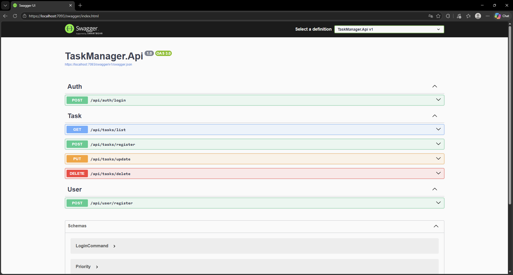

# Task Manager Backend

REST API for managing personal tasks, built with **ASP.NET Core 8** following a layered **Clean Architecture** approach with **CQRS** (MediatR). Users register, log in with JWT, and manage their own tasks.

> 🖥️ **Frontend:** [task-manager-frontend](https://github.com/Carlou134/task-manager-frontend) (Angular)

## Tech Stack

| Concern | Technology |
| --- | --- |
| Framework | ASP.NET Core 8 (Web API) |
| Persistence | Entity Framework Core 8 + PostgreSQL (Npgsql) |
| CQRS / Mediator | MediatR |
| Mapping | AutoMapper |
| Authentication | JWT Bearer |
| Password hashing | BCrypt.Net-Next |
| API docs | Swagger (Swashbuckle) |

## Architecture

```
TaskManagerBackend/          → API layer (controllers, Program.cs, configuration)
TaskManager.Application/     → Use cases: commands, queries, DTOs, mapping profiles
TaskManager.Infrastructure/  → EF Core DbContext, entity configurations, migrations
TaskManager.Domain/          → Entities: User, Role, Task, Priority
```

- **Commands** (write side) are handled through MediatR: `LoginCommand`, `UserCreateCommand`, `TaskCreateCommand`, `TaskUpdateCommand`, `TaskDeleteCommand`.
- **Queries** (read side) are plain services: `IUserQueryService`, `ITaskQueryService`.

## Domain Model

- **User** — `Name`, `Email`, `PasswordHash`, `CreateDate`, `Role`, owns many `Task`s.
- **Role** — seeded with `USER` (1) and `ADMIN` (2). New users get `USER` by default.
- **Task** — `Name`, `Description`, `Priority`, `IsCompleted`, `CreateDate`.
- **Priority** — `Low = 1`, `Medium = 2`, `High = 3`.

## Getting Started

### Prerequisites

- [.NET 8 SDK](https://dotnet.microsoft.com/download/dotnet/8.0)
- PostgreSQL instance (local or cloud)

### Configuration

`appsettings.json` ships with **empty secrets** (`Jwt:Key` and `ConnectionStrings:TaskManager`). Provide them via [user secrets](https://learn.microsoft.com/aspnet/core/security/app-secrets) for local development:

```bash
cd TaskManagerBackend
dotnet user-secrets init
dotnet user-secrets set "Jwt:Key" "<at-least-32-characters-random-secret>"
dotnet user-secrets set "ConnectionStrings:TaskManager" "Host=localhost;Port=5432;Database=taskmanager;Username=<user>;Password=<password>"
```

In production (e.g. Azure App Service), use environment variables instead: `Jwt__Key` and `ConnectionStrings__TaskManager`.

### Run

```bash
# Restore local tools (dotnet-ef)
dotnet tool restore

# Apply migrations
dotnet ef database update --project TaskManager.Infrastructure --startup-project TaskManagerBackend

# Start the API
dotnet run --project TaskManagerBackend
```

The API listens on `http://localhost:5125` / `https://localhost:7093`. In Development, Swagger UI is available at `/swagger`.

## API Documentation

Interactive documentation is available through Swagger UI at `/swagger` when running in Development.



## API Endpoints

| Method | Route | Auth | Description |
| --- | --- | --- | --- |
| `POST` | `/api/user/register` | Public | Register a new user |
| `POST` | `/api/auth/login` | Public | Log in and receive a JWT |
| `GET` | `/api/tasks/list` | `USER` | List the current user's tasks |
| `POST` | `/api/tasks/register` | `USER` | Create a task |
| `PUT` | `/api/tasks/update` | `USER` | Update a task |
| `DELETE` | `/api/tasks/delete` | `USER` | Delete a task |

Protected endpoints require the header `Authorization: Bearer <token>`. The user id is taken from the token, so clients never send `userId`.

### Examples

**Register**

```json
POST /api/user/register
{
  "name": "jdoe",
  "email": "jdoe@example.com",
  "password": "supersecret"
}
```

**Login** (`userName` is the user's `name`)

```json
POST /api/auth/login
{
  "userName": "jdoe",
  "password": "supersecret"
}
```

Response:

```json
{
  "token": "eyJhbGciOi...",
  "expireMinutes": 60
}
```

**Create task**

```json
POST /api/tasks/register
{
  "name": "Write README",
  "description": "Document the API",
  "priority": 2,
  "isCompleted": false
}
```

**Update task**

```json
PUT /api/tasks/update
{
  "id": 1,
  "name": "Write README",
  "description": "Document the API in English",
  "priority": 3,
  "isCompleted": true
}
```

**Delete task**

```json
DELETE /api/tasks/delete
{
  "id": 1
}
```

## CORS

The `AllowAngularApp` policy allows requests from `http://localhost:4200` ([Angular frontend](https://github.com/Carlou134/task-manager-frontend)). Add more origins in `Program.cs` when deploying.

## Deployment

The project includes a Web Deploy profile for **Azure App Service**, backed by Azure Database for PostgreSQL.

## License

This project is licensed under the [MIT License](LICENSE).
